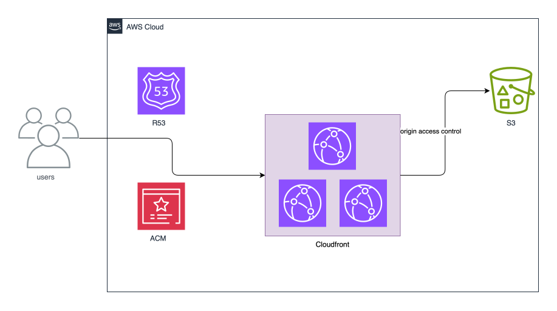

# Project 1 - Static Website Hosting

This project demonstrates how to setup a static web hosting infrastructure on AWS using Terraform.

This solution uses S3 for storage and CloudFront for global content delivery.

---

### Architecture



---

### Project Structure

```text
.
├── README.md
├── dev.backend.hcl
├── dev.tfvars
├── graph.svg
├── locals.tf
├── main.tf
├── output.tf
├── provider.tf
├── static-web-hosting-arch.svg
├── terraform.tf
├── variables.tf
└── www
    ├── index.html
    └── style.css
```

---

### What This Project Does

This project provisions the following AWS resources:

- Account regional namespaced private S3 Bucket versioning enabled for static website storage
- Bucket Policy for allow CloudFront to read objects in the S3 bucket
- CloudFront Distribution for global content delivery

---

> **Note:** This project does not provision a custom domain name or SSL certificate. The CloudFront distribution will use the CloudFront domain name and the default CloudFront SSL certificate.
>
> To add a custom domain name and SSL certificate, you can use AWS Route 53 and AWS Certificate Manager (ACM) to provision a custom domain name and SSL certificate.
>
> Then update the CloudFront distribution's `aliases` to use the custom domain name and `viewer_certificate.acm_certificate_arn` to use the SSL certificate.

---

### Terraform Commands Used

```bash
tf init -backend-config="dev.backend.hcl"

tf validate

tf fmt

tf plan -var-file="dev.tfvars"

tf apply -auto-approve -var-file="dev.tfvars"

tf graph | dot -Tsvg > graph.svg

tf output

tf destroy -auto-approve -var-file="dev.tfvars"
```

---
