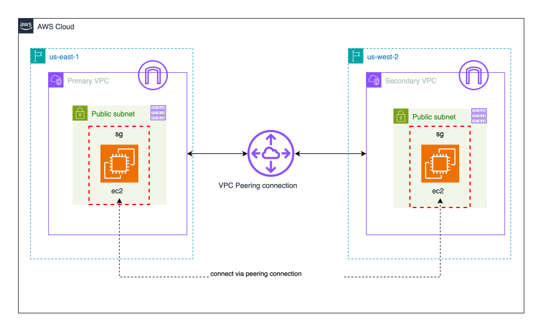
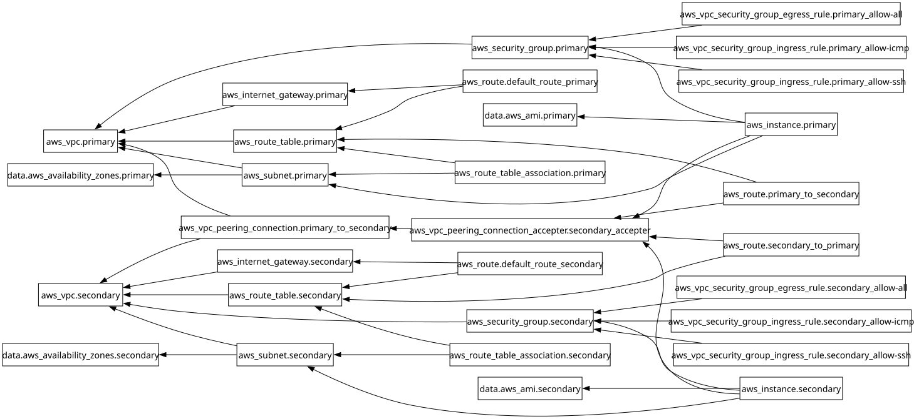

# Project 2 - VPC Peering

This project demonstrates how to setup VPC peering connections between two VPCs in different regions on AWS using Terraform.

---

### Architecture



---

### Project Structure

```text
├── .terraform
├── .terraform-version
├── .terraform.lock.hcl
├── compute.tf
├── dev.backend.hcl
├── dev.tfvars
├── graph.svg
├── locals.tf
├── network.tf
├── output.tf
├── provider.tf
├── README.md
├── security.tf
├── terraform.tf
├── variables.tf
├── vpc-peering-arch.svg
└── vpc-peering.tf

```

---

### What This Project Does

This project provisions:

- Two VPCs in different AWS regions (us-east-1 and us-west-2)
- A VPC peering connection between them
- Public subnets, internet gateways, and route tables in both VPCs
- EC2 instances in each VPC with security groups for SSH and ICMP access

---

### Creating SSH Key Pairs

SSH keys are used to access the EC2 instances in each VPC. You can create them using the AWS CLI as follows:

```bash
# for us-east-1
aws ec2 create-key-pair --key-name p2-vpc-peering --region us-east-1 --query 'KeyMaterial' --output text > vpc-peering-east.pem

# for us-west-2
aws ec2 create-key-pair --key-name p2-vpc-peering --region us-west-2 --query 'KeyMaterial' --output text > vpc-peering-west.pem

# Set permissions
chmod 400 *.pem
```

### Terraform Commands Used

```bash
tf init -backend-config="dev.backend.hcl"

tf validate

tf fmt

tf plan -var-file="dev.tfvars"

tf apply -auto-approve -var-file="dev.tfvars"

tf providers lock --platform=linux_amd64

tf graph | dot -Tsvg > graph.svg

tf output

tf destroy -auto-approve -var-file="dev.tfvars"
```

---

### Testing VPC Peering

After the infrastructure is created, you can test the VPC peering connection:

1. Test Connectivity from Primary to Secondary

```bash
# SSH into Primary instance
ssh -i vpc-peering-east.pem ubuntu@<PRIMARY_PUBLIC_IP>

# Ping the Secondary instance using its private IP
ping <SECONDARY_PRIVATE_IP>
```

2. Test Connectivity from Secondary to Primary

```bash
# SSH into Secondary instance
ssh -i vpc-peering-west.pem ubuntu@<SECONDARY_PUBLIC_IP>

# Ping the Primary instance using its private IP
ping <PRIMARY_PRIVATE_IP>
```

---

### Dependency Graph



---
