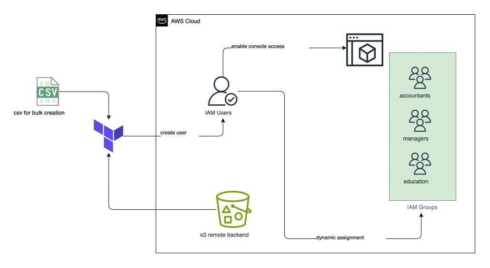
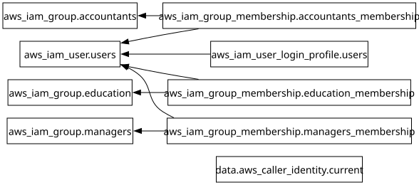

# Project 3 - IAM User Management

This project demonstrates how to manage AWS IAM users, groups, and group memberships using Terraform and a CSV file as the data source.

---

### Architecture



---

### Project Structure

```text
├── .terraform
├── .terraform-version
├── .terraform.lock.hcl
├── dev.backend.hcl
├── dev.tfvars
├── graph.svg
├── iam.svg
├── locals.tf
├── main.tf
├── output.tf
├── provider.tf
├── README.md
├── terraform.tf
├── users.csv
└── variables.tf

```

---

### What This Project Does

This project:

- Creates IAM users from `users.csv`, using each user's first initial and last name as the username.
- Tags each user with their display name, department, and job title.
- Creates console login profiles that require users to reset their passwords.
- Creates the `education`, `managers`, and `accountants` IAM groups.
- Adds users to groups based on department and job title.
- Outputs the AWS account details and the list of created users' full names.

---

### Terraform Commands Used

```bash
tf init -backend-config="dev.backend.hcl"

tf validate

tf fmt

tf plan -var-file="dev.tfvars"

tf apply -auto-approve -var-file="dev.tfvars"

tf providers lock --platform=linux_amd64

tf graph | dot -Tsvg > graph.svg

tf output

tf destroy -auto-approve -var-file="dev.tfvars"
```

---

### Dependency Graph



---
